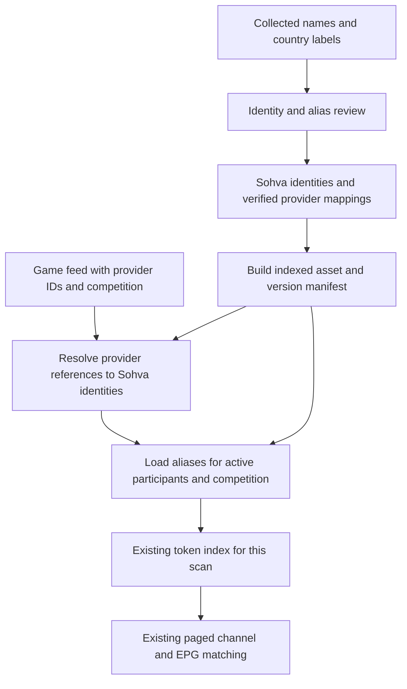

# Sohva Sport dictionary implementation and device test plan

Implementation plan, 2 October 2026. Build a reviewed, provider-independent sports dictionary
and test its matching accuracy and cost on the emulator, Nvidia Shield and slower Elisa box.
Sohva identities own aliases; each provider's IDs are mappings to those identities. Resolve
only the participants and competition in the fixtures being matched. Implement and verify the
phases below in order. Hardware acceptance is recorded separately from implementation.

## Implementation status

Phases 1–6 have code and automated fixtures on `codex/sport-dictionary`. The reviewed first
slice contains 43 identities and compiles reproducibly to an 81,920-byte runtime database.
Collection proposals outside that slice remain pending. All twelve parser/reference round trips,
Room migration 12–13, alias/category/namespace cases, dated membership and competition ranking,
cache invalidation and saved-choice cases have automated checks. The runtime makes no dictionary
network requests and adds no viewer-facing setting or translation work.

Phase 7 is complete on the emulator. Five interleaved runs per mode on both 1 GB and 2 GB
preserve 49 Available owner-scale results; median dictionary CPU cost is within +/-0.4% of the
same-session baseline. The 512-event stress path retains about 2 MiB. Native focus/provider/asset,
migration and indexed-query checks pass, as do 764 unit and 162 desktop-tool tests. Fresh profiles,
release lint/gates, safety/secret/resource audits, exact ART verification and install-profile
acceptance pass. The signed private preview is frozen as build 127; its source, checksums and
receipts are in [preview-builds.md](preview-builds.md). See [performance-log.md](performance-log.md)
for medians, ranges and the retained slow outlier. The first reviewed asset asserts no competition
mappings or rosters; the supporting-context code is covered by synthetic tests.

Phase 8 has started: the owner authorised build 127 on Shield, and its data-preserving update
and matching install profile succeeded. Viewer testing found five fixtures whose numeric name
dates were incorrectly kept Possible despite both teams matching. Follow-up 128 was installed
on Shield with its matching profile after explicit instruction; spec 60 records the date-rule
correction and regression coverage. Viewer acceptance and physical-box budgets remain pending.
Elisa installation requires the owner's instruction for the chosen build.

## Updated collection

The offline pass rebuilt identity links, translations, collision reports and pending profile
priorities. It compared a reconstruction of the first pass against the current data. The
reconstruction reproduced every recorded baseline count. Collected identities, typed entities
and all request ledgers were preserved; the pass made no network requests.

| Measure | First pass on 1 October | Pass on 2 October | Increase |
|---|---:|---:|---:|
| API-Sports teams | 28,484 | 37,699 | 9,215 |
| Teams with additional spellings | 3,609 | 5,407 | 1,798 |
| Distinct team and alias proposals | 7,935 | 12,179 | 4,244 |
| National identities with translations | 959 | 1,496 | 537 |
| Qualified national identities translated | 746 | 1,198 | 452 |
| Shared normalised name groups | 555 | 907 | 352 |

The additions cover 1,706 new identities and enrich 221 existing ones. No prior alias proposal
was withdrawn. Their overlap with previously covered teams explains why those two counts do
not equal the net increase in teams with aliases. Eight country-label languages remain covered:
English, Finnish, Swedish, German, Spanish, Portuguese, Italian and French. Fighters have 1,667
extra source names and drivers 24; these stay separate from teams.

All additional spellings remain pending review. TheSportsDB now provides 163 strong football
ID links; a strong link does not approve its names. The alias evidence includes 140 rows with
category loss, 1,645 with unreviewed identity links and 2,766 with shared names. Those are
overlapping evidence-row counts, not distinct aliases or independent totals.

The local reports are in `.local/team-dictionary/`: `alias_pass_delta.md`, `aliases_added.csv`,
`aliases_removed.csv`, `teams_added.csv`, `alias_review.csv` and `national_alias_gaps.csv`.
There are 3,269 relevant pending TheSportsDB profiles prioritised for later collection.

## Starting point before implementation

The pre-implementation code supplied these matching and persistence mechanisms:

- [TeamVariants](../core/model/src/main/kotlin/com/sohva/tv/core/model/sport/pairing/TeamVariants.kt)
  contains small explicit sport-specific groups and direct bidirectional stored aliases.
- [StreamMatcher](../core/model/src/main/kotlin/com/sohva/tv/core/model/sport/pairing/StreamMatcher.kt)
  creates one token index per scan, consumes the longest complete phrase and treats an alias
  shared by both opponents as ambiguous.
- [StreamPairing](../feature/sport/src/main/kotlin/com/sohva/tv/feature/sport/pairing/StreamPairing.kt)
  reads stored aliases for the sports being scanned. It currently groups those rows by
  canonical name, losing the sport field at that point. A larger dataset needs that field
  preserved throughout resolution.
- [Side](../core/model/src/main/kotlin/com/sohva/tv/core/model/sport/SportEvent.kt),
  [SportsParsers](../feature/sport/src/main/kotlin/com/sohva/tv/feature/sport/provider/SportsParsers.kt)
  and the normalised event cache retain participant names and logos, but not their provider IDs.
- [PairingCache](../feature/sport/src/main/kotlin/com/sohva/tv/feature/sport/pairing/PairingCache.kt)
  is bounded and uses format version 3. Its event fingerprint currently contains names and
  start times, while generation includes stored alias rows.

The contract remains [SPORT-FR-105 through 107 and section 9](rebuild/specs/60-sohva-sport.md):
normalise text, use explicit identities, preserve categories, avoid transitive nickname groups,
and keep pairing paged, cancellable and off the main thread.

## Proposed data flow

The viewer continues to see the provider's names, scores and crests. Every reviewed language
variant can match programme text regardless of the app's interface language. Collection and
source research stay on the build machine; enabling this dictionary uses no viewer API quota.

## Identity and storage

Assign an opaque stable Sohva UUID once to each participant and competition. Persist that UUID
in the build-machine registry and retain it across collection runs, renames, providers and
asset releases. A rebuild must not regenerate identities from names or current provider IDs.

| Record | Key and purpose |
|---|---|
| Participant | Sohva UUID, canonical sport, kind, display name, country and category evidence |
| Participant provider reference | Unique provider + API product + kind + external ID → Sohva UUID |
| Participant alias | Sohva UUID + normalised spelling, with language, source, review and optional validity dates |
| Competition | Sohva UUID, sport, country/region and category; international competitions may span countries |
| Competition provider reference | Unique provider + API product + competition ID → Sohva competition UUID |
| Competition alias | Reviewed names, language variants, abbreviations and dated sponsorship forms |
| Membership | Participant UUID + competition UUID + season/validity, with source and review evidence |

Membership is many-to-many. A club can play in a domestic league, cup and international
competition during one season. Promotion does not create a new club identity. A country's
men's, women's and youth national sides are different participants. Separate clubs sharing
a name stay separate. Provider references never activate a pending cross-provider link.

API-Basketball and API-NBA external IDs retain separate product namespaces. Map records to
the same Sohva participant only with verified evidence; equal numeric IDs prove nothing.
Keep the app's existing follow keys and provider-product enums compatible. MMA participants
are fighters, not gyms. Formula 1 currently matches Grand Prix and circuit names, so team and
driver aliases do not attach to those race sides.

Carry optional provider references for both sides and the competition through parsing, the
event model and persisted day rows. Resolve their Sohva UUIDs against the installed dictionary.
The Room schema needs a migration in the same edit, at its next version; it is currently 12.
Old cached rows keep their names with null references and use conservative exact-name fallback
until a normal feed refresh supplies IDs. Unknown IDs do not block feeds or trigger extra API
calls. Ambiguous names do not acquire an identity by guesswork.

Name fallback is for rows without a provider reference. An explicit but unmapped reference
must not bind to a different identity by its display name. The reviewed export also carries
known collision markers, including collisions with identities outside the shipped slice.
Shipping fewer identities must never make a known shared spelling appear unique. Legacy
built-in and sport-scoped viewer aliases remain usable without inventing a Sohva identity.

Compile accepted mappings and spellings into a separate read-only SQLite asset. Index provider
references by their complete external key, aliases by `(Sohva UUID, normalised spelling)` and
membership by `(competition UUID, season, participant UUID)`. Exact-name fallback has a
sport/kind/category index and returns an identity only when the match is unambiguous. Keep
source evidence and review decisions in the build artifacts and deduplicate runtime spellings.
Keep attribution and licence notices with the shipped asset. Stored viewer alias rows remain
in the existing table and retain the multi-sport repository method; resolution must retain
their sport and avoid merging unrelated canonical identities through a shared alias.

Install the selected asset version atomically after it is first needed, on a background
dispatcher. Verify its manifest and checksum once, reuse that revision in pairing fingerprints,
and close old connections before removing obsolete versions. Opening Home must not unpack or
parse the dictionary. Delivery is initially through app releases under the owner's release
process.

A preliminary desktop size study projected all pending proposals and typed identities into two indexed
tables. It measured 40,369 participants and 12,568 normalised extra names: **5,537,792 bytes**
for SQLite, **1,522,060 bytes** with gzip, compared with **11,184,467 bytes** of team proposal
JSONL. The participant lookup uses a primary-key search. This is a planning model, not an
approved asset; it predates this provider-independent schema and omits mappings, membership,
final metadata, category guards and the manifest. Gzip is only a packaging estimate. Rerun the
size study after the compiler exists; measure the actual APK, heap and Android CPU separately.

## Matching safeguards

Resolve distinct references in the current scan in batches of at most 256 IDs per provider,
product and kind, below SQLite's older 999-variable limit. Read alias rows in keyset pages of
at most 256. Build variants on the bulk dispatcher and release scan state afterward. The
initial design has no permanent participant cache; asset-connection lifetime is explicit.
If profiling justifies a memo cache, start with at most 128 identities and a 512 KiB accounted
size limit, evict by LRU, and measure actual retained heap. The complete catalogue stays on disk.

Page and per-identity limits also need an aggregate scan limit. Account for all resolved names,
category guards, compact variants and token-index entries together, with a maximum of 2 MiB
of accounted dictionary input and 16,384 phrases per scan. Measure retained heap against the
4 MB steady / 16 MB peak budgets; the accounting limit is not a heap measurement. If a complete
identity group would exceed the limit, discard the dictionary contribution for that scan and
use the conservative built-in/stored path. Never truncate an accepted group. Check cancellation
between streaming-copy blocks, lookup pages and index batches, as well as candidate pages.

Evaluate alias and membership validity against each fixture's date, not compilation day.
Deduplication may combine overlapping intervals but must preserve disjoint intervals. Cache
identity includes the fixture date, dictionary content revision and normalisation/rules versions.
The compiler and Android runtime share golden normalisation cases for all eight languages,
combining marks, punctuation and supplementary Unicode characters. Record a normalisation
version in the manifest; process Unicode code points rather than separate UTF-16 surrogates.

Keep the existing confidence, time-window, manual decision and channel-order rules. An alias
shared by the two opponents remains ambiguous. ID-based lookup chooses the intended identity's
group, but programme text still needs two independent participant mentions for the existing
strong confidence conditions.

Category preservation also needs a runtime check. A men's alias such as `Suomi` is a whole-word
prefix of `Suomi U21` or `Suomi W`; preserving suffixes in the dictionary alone cannot stop a
senior match from using that text when the qualified team is absent from the scan. Add explicit
qualifier guards and longest-phrase exclusion fixtures for youth, women's and reserve identities.
Use sourced category forms and known qualified identities, rather than generic guesses from
city or name tokens. The exact guard representation is still an implementation choice.

League and competition names provide supporting evidence after participant/date matching.
Recognised agreement can rank an otherwise equivalent candidate higher; absent league text
is neutral. An explicitly incompatible competition can flag uncertainty, but country or
language tags such as FI/DE are not league evidence. Competition text cannot promote a
single-team, wrong-date or category-conflicting candidate to Available. Introduce this ranking
in a separate phase so accuracy and CPU can be compared with aliases alone. Existing numeric
team/time scores and confidence tiers remain unchanged in the first preview.

Competition agreement ranks after confidence, viewer language priority, unchanged numeric
score and time distance, and before stable name/key ties. Apply that same position when choosing
a channel's candidate, presenting results and restoring the binary cache. Missing, agreeing
and conflicting competition evidence never alter the score or confidence tier in this preview.

For NAME/M3U candidates, stated clocks only rank results, even when a time zone is supplied:
two independent participant mentions and a compatible date remain Available despite different
country-feed clocks. Actual GUIDE timestamps retain the 30-minute Available condition and
120-minute candidate window. Invalid or incompatible dates remain Possible. Either valid
reading of a numeric date may agree with the fixture date; this does not establish a provider's
date order. Explicit years and zones still govern date comparisons across midnight, including
literal EDT (UTC−4). See the owner's 2 October correction in spec 60.

Include dictionary revision, provider references, resolved Sohva identities and matching-rule revision in the cache
identity. Advance the result-cache format and rescore derived results after the change. Keep
saved confirm/reject decisions. The scan trigger must also notice participant identity/name
corrections without rescanning for score-only updates; it currently compares event ID/start
pairs. Older cached events without IDs remain usable through the conservative fallback.

## Implementation phases and completion gates

### 1 Establish the baseline and test corpus

Record current parser, pairing, cache and schema behavior before changes. Capture dictionary
counts, asset/build revision and existing built-in groups. Reuse the rebuild's current tests,
including `TeamAliasMatchingTest`, `ProviderNameMatchingTest`, `ProviderNamePairingTest`,
`PairingScanTest`, `PairingCacheTest`, `SportsParsersTest`, `SportsRepositoryTest` and
`PairingOwnerScaleTest`. Do not copy old app code.

Create a fixed labelled corpus with dates generated relative to the test clock. Include both
channel-name and guide candidates, a representative slice of every supported sport/product,
and explicit expected Available/Possible/no-result outcomes. Separate expected alias gains
from existing positive controls and unrelated negatives. Write regressions first and demonstrate
failures for discarded IDs, lost stored-alias sport and senior/qualified prefix collisions.

Gate: baseline results and CPU/memory measurements are saved, fixtures have expected outcomes,
and current positive cases are reproducible. Keep all fixture URLs reserved and secrets absent.

### 2 Create stable identities and a reviewed registry

Extend desktop research storage with the identity, provider-reference, competition and
membership records above. Migrate without changing collection checkpoints or quota ledgers.
Seed persistent Sohva UUIDs once from the collected records. Retain unresolved duplicate
identity candidates instead of merging by name or shared alias. Provide review operations for
bindings and aliases, with provenance and a reproducible export.

Start the preview's reviewed slice with Finnish/English/German national forms, separately
identified women/youth sides, Huuhkajat/Helmarit/Leijonat and selected club forms relevant to
the current football/hockey follows. Add controls for the remaining products. The compiler
ships only accepted data. The 907 shared-name groups and 140 category-loss evidence rows stay
in the review queue until resolved; do not require reviewing every proposal to test a safe slice.

Add verified competition names and membership incrementally from already available responses.
Do not assume country-wide collection establishes league rosters. Retain season/validity and
unknown coverage; further API collection keeps the existing budgets and pacing.

Gate: repeated exports preserve UUIDs; a reviewed alias group can be resolved through two
different provider references; pending/rejected bindings or aliases cannot enter the asset.
Use a synthetic second provider for this proof, without credentials or network requests.

### 3 Preserve references through feeds and cached events

Add typed optional participant and competition references to the model. Retain IDs from each
existing parser, including NBA visitor sides, MMA fighters and F1 competition/circuit roles.
Update normalised event storage and its read/write mapping together with the Room migration
and migration tests. Keep existing event IDs, follow keys, reminders and saved stream decisions.

Gate: all twelve product fixtures preserve references across parse → store → read; older rows
still load without invented IDs; names/crests/UI remain unchanged; no extra API requests occur.
Provider-independent fixture IDs and migration of saved choices across a future provider switch
are separate work: this plan makes the dictionary portable, not the entire sports service.

### 4 Compile and install the indexed asset

Create a deterministic compiler and manifest with format version, content revision/hash, row
counts and credits. Validate referential integrity, sport/type/category consistency, duplicate
bindings, minimum normalised lengths, alias validity and review status. Equivalent source
spelling rows collapse into one runtime variant. Start with a compiler limit of 64 variants per
identity; an oversized group requires review and must not be silently truncated.

Generate the asset under ignored build output from reviewed source data. Update the source/APK
audits narrowly where needed for the verified generated asset; the full research DB, raw
responses and credentials remain excluded. Test hot-query plans and actual packaged size.
Install lazily with bounded streaming I/O and atomic replacement. Missing, corrupt or unsupported
assets fall back to the existing built-in and stored aliases and do not prevent Today opening.

Gate: deterministic output, only reviewed records, indexed lookup, recovery from interrupted
installation, unchanged Home startup work, and the APK remains below its 10 MB ceiling.

### 5 Connect aliases and category guards to pairing

Resolve provider references to Sohva identities for the current games, then load their aliases.
Adapt the current token index rather than scan the catalogue per channel. Keep stored aliases
scoped by sport and preserve direct bidirectional behavior without transitive group merging.
Use sourced qualifier forms and known qualified variants to stop adult aliases matching youth,
women's or reserve phrases even when those qualified fixtures are absent from the scan.

Update generation, event signatures and cache fingerprints for dictionary/identity changes;
advance result-cache format 3 to its next version. Recompute automatic results and preserve
manual Confirm/Reject/Restore choices. No rescan for score-only updates; identity/name changes,
new assets or source generations do trigger a cancellable rescan. Pause bulk work during playback.

Gate: all baseline positives remain correct, added alias cases improve, negative cases gain no
false Available results, and restarting restores valid results without another guide scan.

### 6 Add competition context as a separate comparison

Resolve reviewed competition aliases by stable competition identity and optional season.
Extract whole phrases once per candidate and reuse the result; never loop through all leagues.
Add supporting agreement as a ranking tie-break within the existing confidence tier. Missing
competition text remains neutral; conflicting names and ambiguous labels have explicit tests.
Membership supports context without treating one domestic league as a team's permanent identity.

Gate: compare the same corpus with baseline, aliases alone and aliases plus competition hints.
Record accuracy and CPU for each. Competition hints must not weaken date/category exclusions,
promote a single-team candidate or change country/language stream ordering. Document any later
proposal to change numeric scores separately against SPORT-FR-113 through 118.

### 7 Verify on the emulator and prepare one private preview

Run unit tests, migration/query-plan tests, targeted UI instrumentation and owner-scale matching
on a cold-booted 1920×1080 TV emulator, API 30+, at both 2 GB and 1 GB. Use current-date fixtures,
isolated data and the shared cleanup rule in `finally`. Send Back through instrumentation and
hold real repeated remote keys with slow/gated data to verify focus during result publication.

Run required debug/lint checks, source/secret scans and release gates. Verify the exact shrunk
APK's dex on the emulator and include matching generated Android 9–11 and 12+ install profiles.
Freeze one preview with source commit, dictionary hash, APK/profile hashes and test receipts.
Check `preview-builds.md` before allocating its version code: build 126 is already frozen, so
the next preview needs at least 127 and must also exceed any newer reservation. Do not modify
or overwrite the subtitle preview or publish a new beta for each implementation phase.

Gate: the signed preview passes the accuracy and performance criteria below. Device installs
are a later action with the owner's explicit instruction for that exact build and device.

### 8 Test the same preview on Shield and Elisa

Record each device's current app/build, Android version, memory tier, dictionary revision,
catalogue counts and relevant accessibility services. Compare before/after on each device using
the same inputs. Shield results do not substitute for Elisa results. The owner operates the
remote; any instrumented run or trace capture has separately agreed scope.

Use an update that preserves data. Household app data is never cleared or populated with the
synthetic owner-scale fixture. Destructive fixture seeding stays on the emulator; optional
controlled hardware instrumentation uses an isolated test package/database only when authorised.
Do not change display, screensaver or animation settings, or drive a real TV with blind ADB keys.
Run short test sections so neither device needs a settings change to finish.

Gate: the same frozen APK/profile pair is identified on both devices, labelled correctness
checks pass, the Elisa budgets hold and the viewer reports no focus/playback regression.
Save redacted receipts per device and update `docs/performance-log.md` with measured results.

## Correctness test matrix

| Area | Positive case | Required negative or persistence case |
|---|---|---|
| Provider independence | Two synthetic provider IDs resolve to one Sohva participant and the same aliases | Same numeric ID in different providers/products never binds implicitly; UUID survives export/release |
| Language variants | Finland/Suomi, Germany/Saksa/Deutschland, sourced native nicknames and club forms | Language choice does not activate unrelated country/team identities |
| Categories | Finland U21/Suomi U21 and Finland W/Suomi W | Senior fixture cannot match those phrases; B/reserve and women's words cannot be dropped |
| Namespaces | Football/hockey and NBA/Basketball use verified references | Shared text across sports, fighter versus gym and F1 driver/team versus race/circuit stay separate |
| Shared names | Distinct mentions prove both opponents | A repeated shared nickname alone does not prove both; no transitive alias merging |
| Competition and season | Reviewed league phrase improves an equivalent ranking; cup and league memberships coexist | Missing league text stays neutral; promotion and international/cross-border fixtures remain valid |
| Time | Compatible NAME dates, including either numeric order, remain Available across different country-feed clocks; GUIDE timestamps use the existing 30/120-minute rules | Wrong/invalid/unresolved dates are not promoted by league evidence; explicit years/zones preserve midnight boundaries |
| Persistence | Valid restart uses cache; Confirm/Reject/Restore and hidden channels survive update/import | New dictionary/identity invalidates automatic cache; score-only update does not rescan |
| Failure | Unknown reference/corrupt asset uses conservative fallback | No guessed identity, crash, lost feed or extra quota from dictionary lookup |
| Focus and cancellation | Repeated D-pad and Back work while results arrive | Refresh never steals focus; newer generation/playback cancels before further work beyond one page |

## Performance acceptance and evidence

Existing budgets come from [plan 07](rebuild/plan/07-performance.md) and
[spec 60 sections 9 and 11](rebuild/specs/60-sohva-sport.md). The relative regression threshold
below is a proposed gate for this implementation; measure it before accepting the preview.

| Measure | Acceptance |
|---|---|
| Sport steady retained heap | At most 4 MB for sport state, including dictionary-related state |
| Pairing scan peak working set | At most 16 MB; one scan at a time; zero CursorWindow-full warnings and no OOM |
| Feed parse/publish | At most 300 ms per sport off the main thread on the low-end box |
| UI opening and held keys | Chrome in the first frame; first data within 300 ms on Shield / 700 ms on Elisa; key response within two device vsyncs |
| Startup | No dictionary copy/open/parse before first frame; existing startup budgets continue to pass |
| Catalogue paging | 256 channel / 64 programme candidates per page; alias pages at most 256; cancellation within one candidate page |
| Warm result cache | Reopening/restoring unchanged results performs no channel/programme scan |
| CPU comparison | Proposed: median total pairing CPU increase no more than 10% on the same labelled workload, with improved alias coverage; record index-build and lookup phases separately |
| Package and storage | APK at most 10 MB; report asset size, first install cost and peak two-version disk use |
| Accuracy | Zero new false Available outcomes in the labelled negative corpus; positive controls retained; expected alias-only gains demonstrated |

Use at least five comparable runs for each mode/device where practical, distinguish cold asset
installation from warm lookup, and report median and range. Record compile/profile state and
device thermal state; do not mix differently seeded workloads. On the emulator compare CPU
per phase rather than treating its frame times as hardware evidence. On hardware record frame
and key-response measurements as well as CPU and heap.

Extend `PairingOwnerScaleTest` with the full-sized dictionary/resolver path: 56,164 channels,
112,328 programmes with long descriptions, and a separate 512-event/cache-capacity case.
Use a correctly sized dictionary even when the first approved release slice is small. The
stress dictionary is synthetic and test-only; it does not bypass review for the shipped asset.

Capture participant/mapping counts, alias-row/query counts, channel/programme pages, cold
install time, lookup/index/scan CPU, retained/peak heap, GC, frame/key timings, cancellation
delay, cache reuse and Available/Possible counts. Do not log API keys, stream URLs or raw EPG
text. Real mismatches become sanitised fixtures, with the underlying source checked before
another alias is accepted.

## Owner device checklist

Run this list on Shield, then repeat on Elisa with that device's own before/after baseline.

1. Update with the exact agreed preview, keeping existing sources, follows and manual decisions.
   Confirm build/profile/dictionary revision and that opening Home behaves as before.
2. Open Today and the hub for known football and hockey fixtures. Check team aliases in channel
   names and EPG, including Finland/Suomi where a suitable fixture is available. Record expected
   gains and any unrelated stream newly shown as Available.
3. Check a women's/youth/reserve fixture when available. Confirm it does not borrow a senior
   broadcast. Use the automated fixtures for categories not present in today's real listings.
4. Scroll and hold the D-pad during a refresh, open/close the hub and use Back. Focus must stay
   where chosen and return to the opening card; compare responsiveness with the baseline.
5. Confirm, reject and restore a stream; restart the app and reopen Today. Results and choices
   persist, and unchanged inputs reuse the cache. A refresh with only score changes stays cheap.
6. Play a stream with sport overlays hidden, then with the ticker enabled. Check picture/audio
   stability and confirm bulk matching pauses rather than competing with decoding.
7. Save redacted diagnostics and the short mismatch checklist. End the section before inactivity
   settings interfere; resume another section later without changing those settings.

Hardware tests use the viewer's normal follows/cache and do not repeatedly fetch every sport.
Dictionary lookup itself makes no API request. Network-dependent cases must respect the current
account quota; synthetic provider-portability tests require no second subscription.

## Preview recovery and completion

A corrupt asset or unresolved mapping falls back without clearing state. If hardware testing
finds a regression, prepare a higher-version-code follow-up preview that disables the new
dictionary path while retaining the new compatible schema and viewer data. Do not downgrade
the installed APK, overwrite a frozen build or clear household app data as recovery.

Implementation is complete when reviewed sources and stable mappings are reproducible; baseline,
new-provider and negative fixtures pass; migrations and query plans pass; emulator and both
hardware results meet the budgets; and the owner device checklist has receipts. Record decisions,
performance and relevant SPORT-FR inventory coverage only after those gates pass. Any new
viewer-visible messages use resources in all eight current languages. Publishing remains the
owner's separate release decision.
